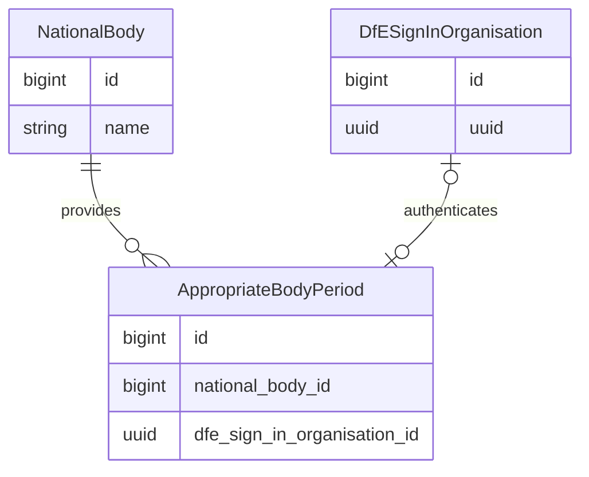
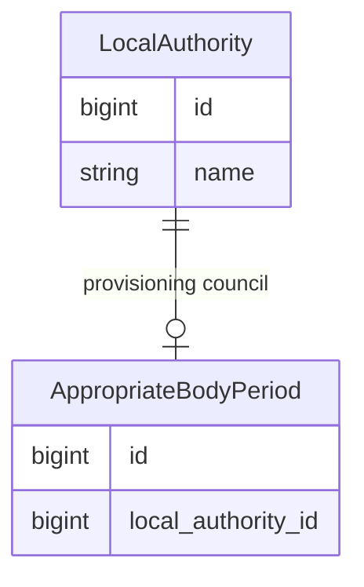
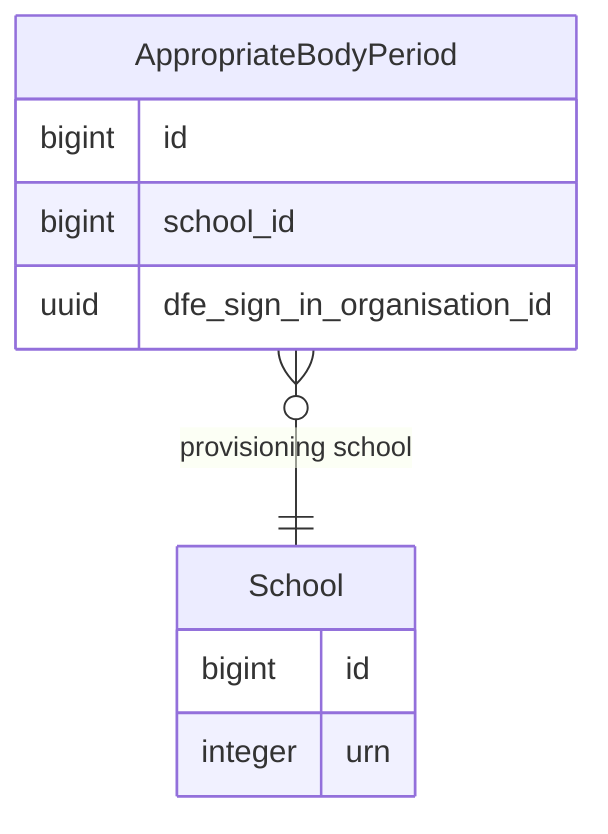
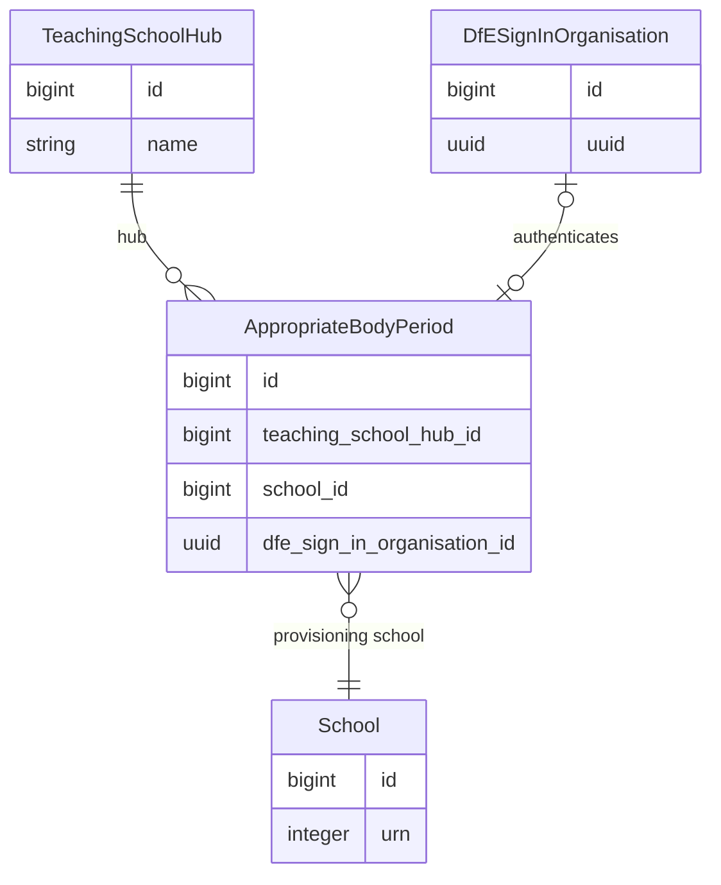
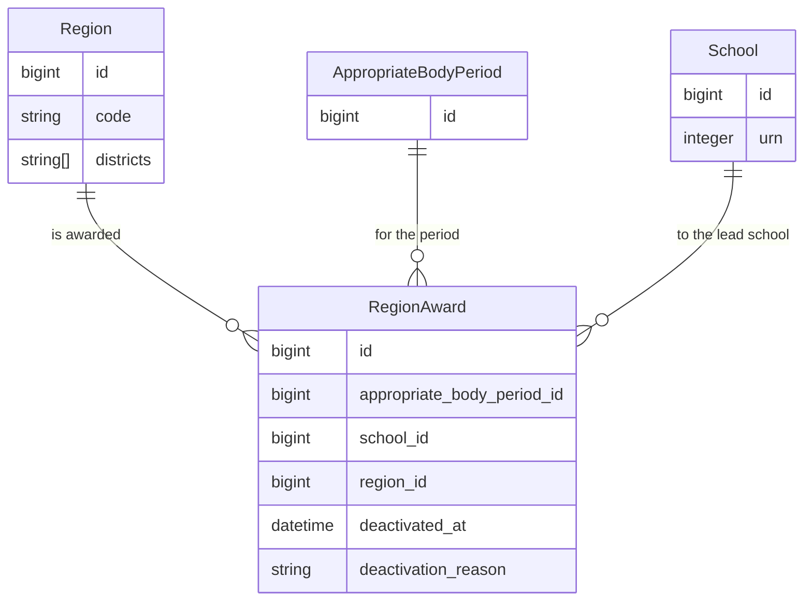

An appropriate body is the organisation that assures the quality of an early career teacher's statutory
induction. In RIAB an appropriate body is represented as a **period** which links to the provider that runs
it. Induction periods are recorded against an appropriate body period.

## The data model

| Table | What it holds |
| --- | --- |
| `appropriate_body_periods` | A period of time that bounds induction periods and links to one of four body types, only two are currently operating. |
| `local_authorities` | Legacy providers whose data was imported from the predecessor service. |
| `schools` | Legacy providers known as "teaching schools" which were replaced by "teaching school hubs". |
| `teaching_school_hubs` | An organisation of potentially more than one school which is awarded a geographic region. |
| `national_bodies` | An organisation that operates nationally without a provisioning school. |
| `region_awards` | Regions are awarded to lead schools for a number of years before being reevaluated. |
| `dfe_sign_in_organisations` | A record of the establishment a user can sign in from using DfE Sign-In. |

## Authentication

If the user enters with an organisation authentication `UUID` that matches an appropriate body period,
and has the `AppropriateBodyUser` role, they will be granted access to `Record Inductions as an Appropriate body`.

An active appropriate body can either be a **National Body** or a **Teaching School Hub** with an
ongoing appropriate body period. The service does not currently support closing appropriate body periods.

See [DfE Sign-In](./dfe-sign-in.md).

## National bodies

A national body has no regional limit, and is not linked to a school. There are currently
two active national bodies, **ISTIP** and **ESP**, whilst a third has closed, **NTA**.

- The data model allows a national body to hold more than one period if this becomes necessary.
- A closed national body holds no DfE Sign-In organisation, so no user can sign in to it.

## Local authorities

A local authority is a legacy body type with a closed period. It takes on no new inductions and
cannot be accessed via DfE Sign-In.

- The model declares one period per local authority.
- All LA periods share the same start and end dates.

## Teaching schools

A teaching school is a legacy body type with a closed period. It is a `school` that acted as an appropriate body before
2021, referred to as the **provisioning school**. It takes on no new inductions and cannot be accessed via DfE Sign-In.

- A teaching school period has an end date, because no teaching school operated as an appropriate
  body after 31 August 2021.
- The appropriate body period can only start after the school has opened and must finish on
  or before the school closes.
- The same school may currently operate as a hub type body which can authenticate.

## Teaching school hubs

A teaching school hub is an active type of provider meaning most have an ongoing period.
The period links two records: the hub, and the school responsible for provisioning it.

- It is possible for a hub to hold several concurrent periods, see [large hubs](#large-hubs).
- A **provisioning school** is mandatory.
- Additional **lead schools** are possible, see [regional awards](#regional-awards).

## Regional awards

A region identified by a short code groups districts. The `regions` table holds the
finite list of codes and their district names.

An award joins three records: region, appropriate body period, and school.
The school is the **lead school** for its region(s) until it is awarded to a different school.

A region has at most one active award, so a region serves one provider at a time;
a period has at most one active award for a given region.

- A period holds many awards, one per region it covers.
- A school may be the lead school for many regions, and for more than one period.
- The districts of an award come from its region, not from the award.

## Large hubs

When an establishment wins multiple regional awards it will operate across multiple lead schools.
It is at the organisation's discretion which of these will be responsible for providing appropriate body services.

A large hub could therefore form a group represented as **one hub with several concurrent periods**.
Each period operating as its own appropriate body and referred to as a hub in its own right.

A hub with four lead schools could organise itself into four appropriate bodies giving each school responsibility
for a collection of inductions and making them provisioning schools. Likewise, a hub could decide to close an
appropriate body.

At present two organisations operate in this manner:

- `Star Teaching School Hub Network` with two bodies **Birmingham South** (one lead school) and **Pennine Lancashire** (three lead schools).
- `Five Counties Teaching School Hub Alliance` with two bodies **Somerset** (two regions, one lead school) and **South Glos/BANES** (one lead school).

## Trading display names

The majority of hubs will be a single school, similar to how old teaching schools operated.

Teaching schools operated as appropriate bodies under a name that was often different to the school.
The data model provides a `name` field on the period to override the school name.

Similarly, if a hub is large and begins to operate multiple appropriate bodies, the `name` field allows the data model
to accommodate name changes and concurrent periods.

The RIAB data is transitioning to support flexible provisioning for hubs. Meaning **a name is not to be treated as an identifier.**
